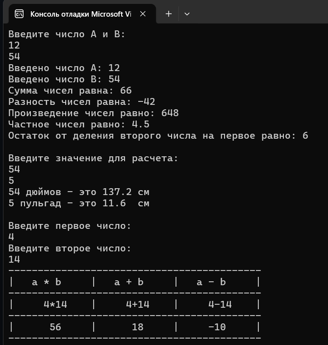

# Лабораторная работа 3

## Цель работы
Получение навыков написания программ с вводом/выводом данных и простыми вычислениями

## Результаты работы программы

## Информация о разработчике
Орлова Эльвира Эдуардовна
Группа: бИД-261
